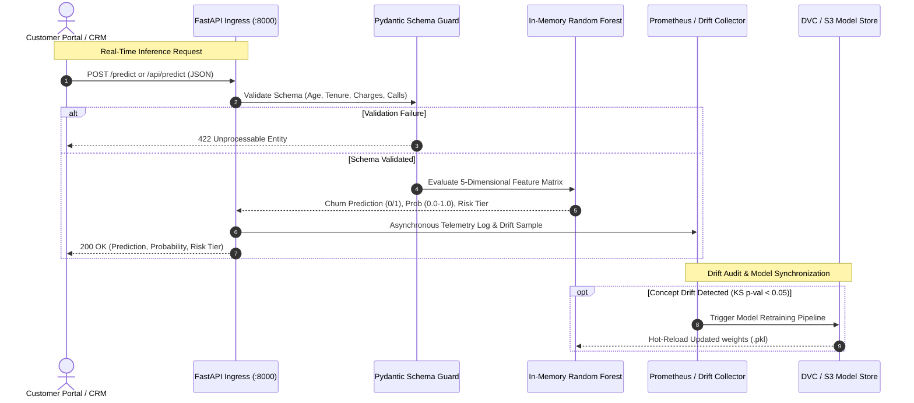

# 🏛️ Real-Time MLOps: Enterprise System Architecture & Serving Specifications

> **High-Throughput, Low-Latency (Sub-50ms) Production Churn Prediction Engine with DVC Versioning, GitOps Continuous Delivery, and Automated Drift Detection.**


---

## 📑 Architectural Blueprint & Overview

The **Real-Time MLOps Platform** delivers high-concurrency customer churn prediction with strict sub-50ms response SLAs, automated model version control (DVC + S3), continuous validation pipelines, and declarative GitOps deployments across containerized infrastructure.

```
+-------------------+       +--------------------+       +----------------------+
|  Web/Mobile Apps  | ----> |  FastAPI Gateway   | ----> | Scikit-Learn Model   |
|  & CRM Portals    |       |  (Schema Validate) |       | (In-Memory <15ms)    |
+-------------------+       +--------------------+       +----------------------+
                                      |                             |
                                      v                             v
                            +--------------------+       +----------------------+
                            | Prometheus Telemetry|       | DVC Artifact Store   |
                            | & Drift Detection  |       | (AWS S3 Versioning)  |
                            +--------------------+       +----------------------+
```

---

## 🧩 Enterprise AI Architect Roadmap (Phases 0 – 5)

### Phase 0: Base Service Foundation & SLO Design
- **High-Performance Serving**: FastAPI powered by Uvicorn ASGI workers with multi-core event-loop scheduling.
- **Strict Latency Budget**:
  - `p50 Latency`: $\le 10\text{ms}$
  - `p95 Latency`: $\le 35\text{ms}$
  - `p99 Latency`: $\le 60\text{ms}$
- **Contract Strictness**: Pydantic v2 data models enforcing numerical bounds (`age: 18-100`, `tenure: 0-120`, `charges > 0`).
- **Telemetry Endpoints**: `/health` (liveness/readiness check) and `/metrics` (Prometheus-compatible scrape target).

### Phase 1: Core Machine Learning Engine
- **Algorithmic Selection**: `RandomForestClassifier` with 100 decision trees, Gini impurity criterion, and sub-sample bagging for robust non-linear boundaries.
- **Core Feature Dimensions**:
  1. `age`: Customer demographic maturity.
  2. `tenure_months`: Loyalty tenure period.
  3. `monthly_charges`: Current billing rate.
  4. `total_charges`: Cumulative lifetime billing.
  5. `num_support_calls`: Friction and service grievance indicator.
- **Evaluation Criteria**: Minimum AUC-ROC of `0.65` and validation accuracy $> 62\%$.

### Phase 2: Data Version Control & MLOps Pipelines
- **DVC Integration**: Dataset snapshots (`data/churn_data.csv`) and model binaries (`models/churn_model.pkl`) tracked via SHA256 pointers (`.dvc`), decoupling heavy binaries from Git.
- **Remote Artifact Storage**: AWS S3 object store with KMS server-side encryption and versioned object locking.
- **GitOps Delivery**: ArgoCD continuous delivery engine synchronizing `k8s/` manifests to target Kubernetes clusters with automated rollbacks.

### Phase 3: Drift Detection & Automated Retraining
- **Covariate Shift Auditing**: Continuous Kolmogorov-Smirnov (KS) two-sample testing on production inference feature streams versus baseline training distribution.
- **Drift Threshold**: Statistical $p$-value $< 0.05$ automatically fires alert webhooks to trigger data re-collection and automated retraining.
- **Dynamic Risk Categorization**:
  - `HIGH RISK`: Probability $> 0.60$ (immediate retention workflow).
  - `MEDIUM RISK`: Probability $0.30 - 0.60$ (promotional incentive targeting).
  - `LOW RISK`: Probability $< 0.30$ (standard lifecycle).

### Phase 4: High-Throughput Event Streaming
- **Stream Ingestion**: Kafka event consumer integration for batching real-time customer event activity.
- **Containerization**: Multi-stage minimal Docker container (`python:3.11-slim`) under 250MB with zero compilation baggage.

### Phase 5: Governance, Model Cards & FinOps
- **Zero-Cost Teardown**: Idempotent `./clear.sh` cleaning 100% of local processes and orphan containers for **$0.00 idle spend**.
- **Model Card**: Complete tracking of hyperparameter choices, feature importances, and distribution baselines.

---

## 🔄 End-to-End Inference & Drift Sequence Flow



---

## ⚡ Deployment & Verification

| Mode | Command | Footprint |
| :--- | :--- | :--- |
| **Zero-Touch Cloud Bootstrap** | `curl -fsSL https://raw.githubusercontent.com/KishorKumarParoi/realtime-mlops/main/bootstrap.sh \| bash` | Bare EC2 / Cloud VM |
| **Lightweight Python Standalone** | `./deploy.sh --standalone` | Local (<15s) |
| **Containerized Stack** | `./deploy.sh` | Docker / Compose |
| **Zero-Cost Teardown ($0.00)** | `./clear.sh` | Clean compute |
